In [Math Magic April 1999](https://erich-friedman.github.io/mathmagic/0499.html) Erich Friedman introduced the concept of Convex Spectra. In this post, I present a variation of that problem - Convex Hole Spectra.

Specifically, we call a shape n-hole-convex if n non-overlapping copies of the shape can be arranged into a convex shape, with exactly one convex hole, such that the hole does not touch the boundary of the completed convex shape at any point. A shape's convex hole spectrum is the set of n for which the shape is n-hole-convex. 

While shapes with infinite convex hole spectra exist, in this post I present only shapes with finite convex hole spectra. 

I've attempted to attribute authorship correctly when a shape or outline was discovered by someone specific, even though their discovery of shape or outline may predate this question.

The following table shows shapes with finite convex hole spectra. 

| Shape      | Spectrum | Author |
| ----------- | ----------- | ------- |
|       | {2,8,10}       | Yoshiaki Araki  |
| 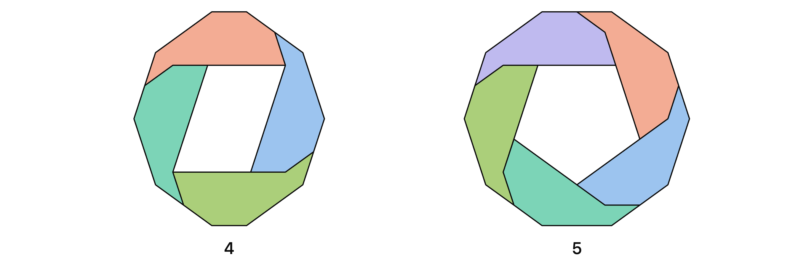      | {4,5}       |  |
|       | {2,3}       |  |
| 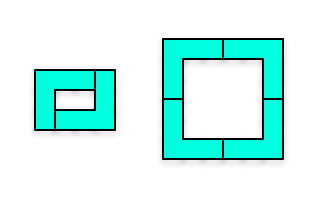      | {2,4}       | George Sicherman |
|       | {2,3,4,6,7,8}       | Andrew Bayly, George Sicherman |
|       | {6,10}       |  |
| 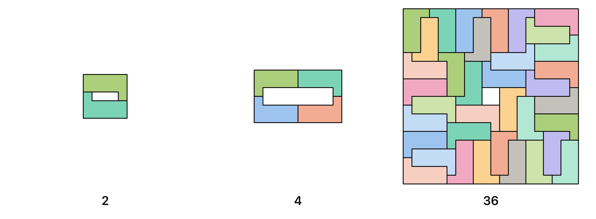      | {2,4,36}       | George Sicherman |
| 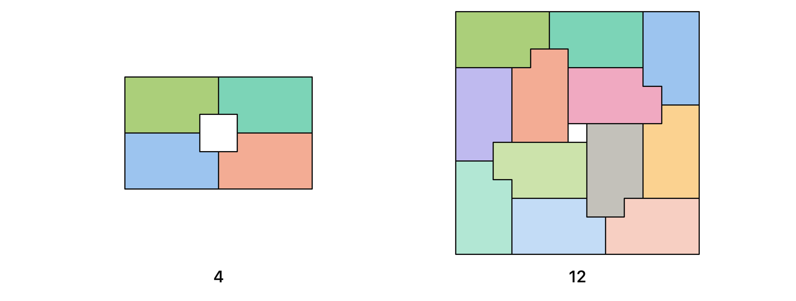      | {4,12}       | Mike Reid |
| 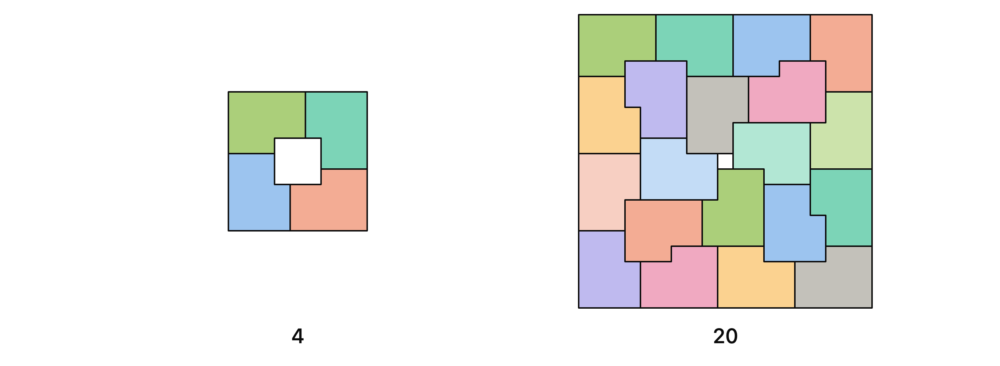      | {4,20}       | Mike Reid |
| 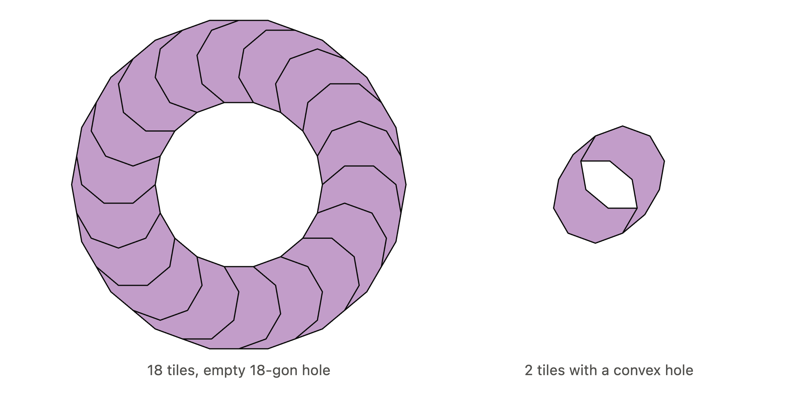      | {2,18}       | Yoshiaki Araki |
| 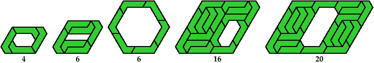      | {4,6,16,20}       | George Sicherman |
| 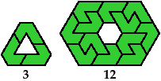      | {3,12}       | George Sicherman |
| 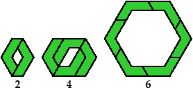      | {2,4,6}       | George Sicherman |
| 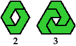      | {2,3}       | George Sicherman |
| 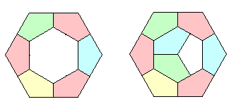      | {6,8}       | Mike Reid |
| 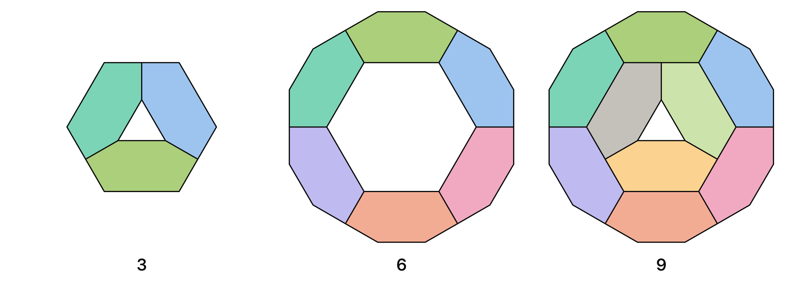      | {3,4,6,9}       |  |
| 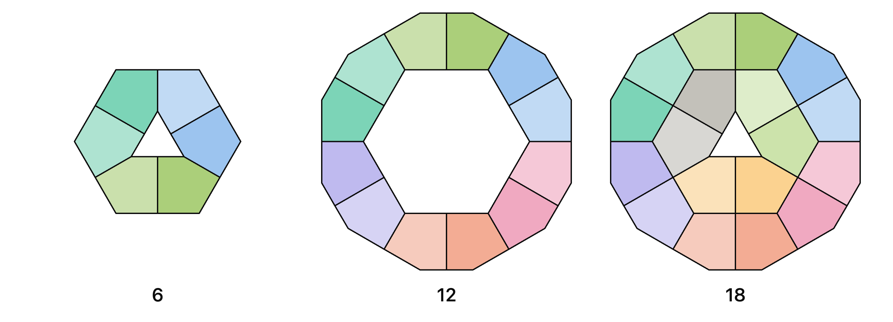      | {6,8,12,18}       |  |
| 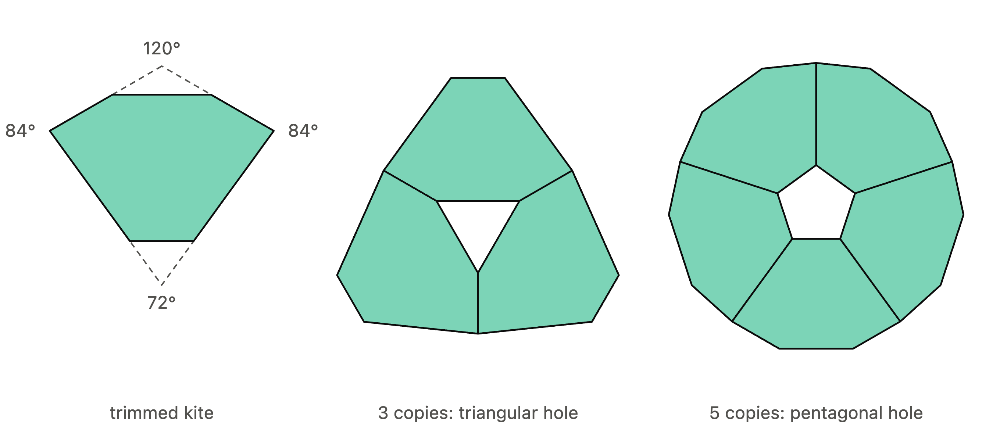      | {3,5}       |  |
| 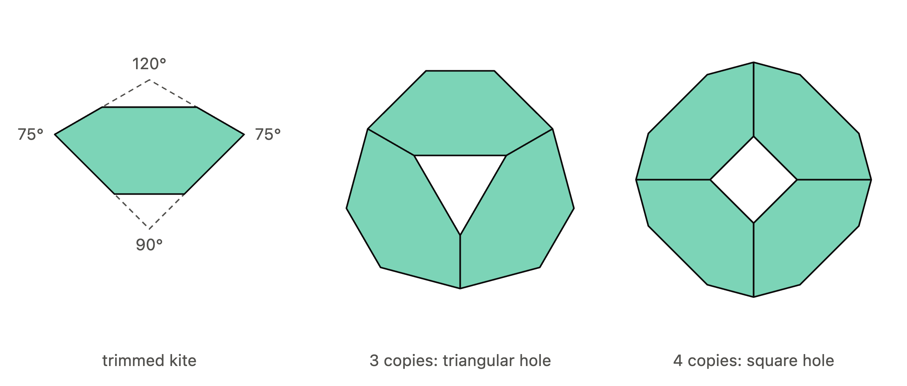      | {3,4}       |  |
| 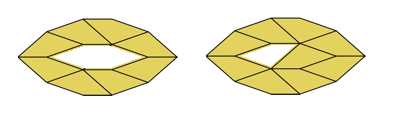      | {8,9}       | Yoshiaki Araki |
|       | {6,12,15}       | Karl Scherer |
| 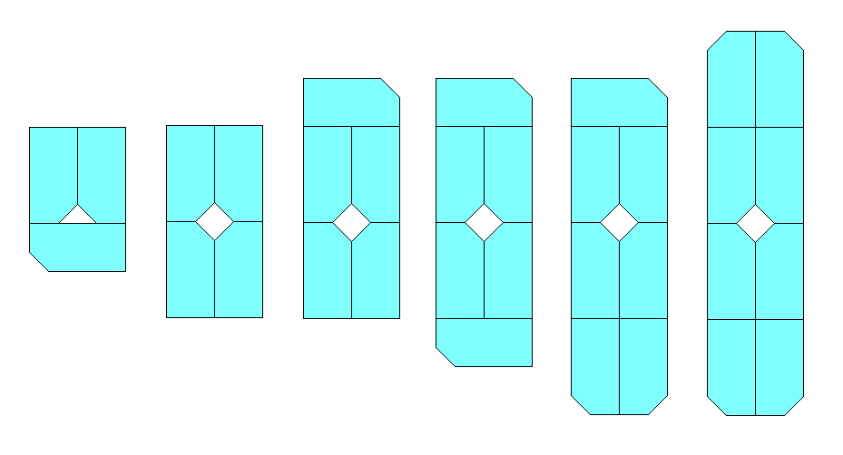      | {3,4,5,6,7,8}       |  |
|       | {8,9,18,19}       | Yoshiaki Araki |
|       | {7,8,9,12,14, 15,16,17,19,21, 23,24,25,28,29, 31,32,33,35,36, 38,39,41,42,43, 46,47}       | Karl Scherer, George Sicherman  |
|       | {8,9,14,15,16,17,18,19,20}       | George Sicherman |
|       | {4,5,6,7,8,9,10}       |  |
| 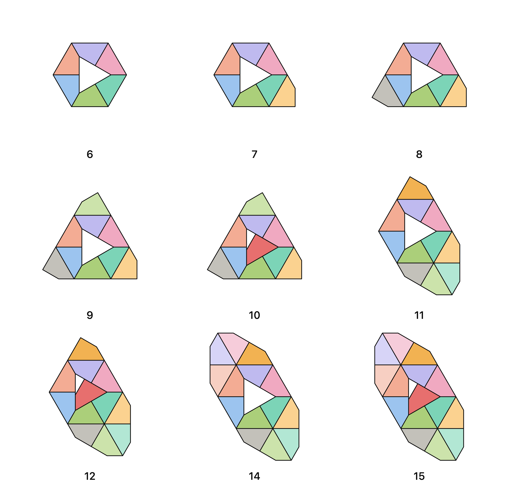      | {6,7,8,9,10,11,12,14,15}       |  |
| 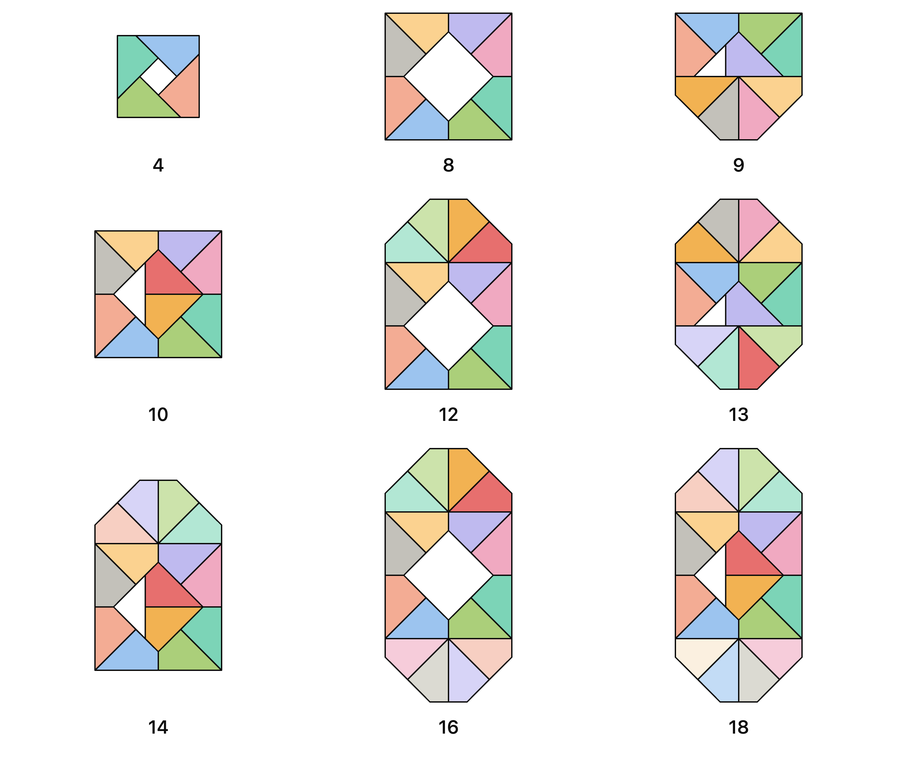      | {4,8,9,10,12,13,14,16,18}       |  |
|       | {4,8,20,21,22,24}       | Yoshiaki Araki |
|       | {3,4,5,6,8}       |  |
| 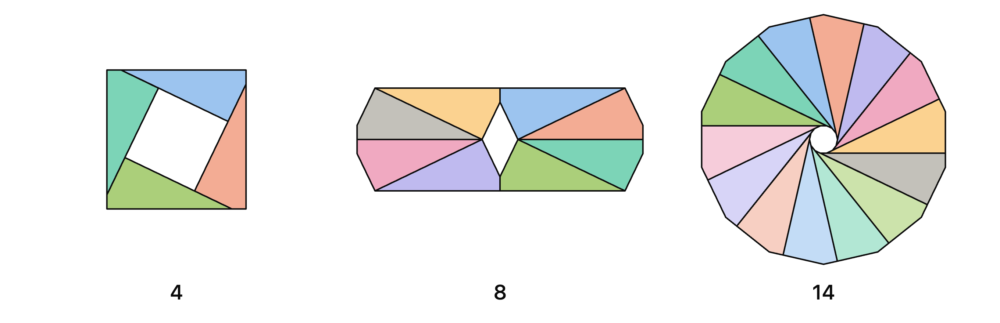      | {4,8,14}       |  |
|       | {3,4,6,8,12}       |  |
|       | {5}       |  |

If you can extend these results - please email me: andrew.bayly@mac.com
