In [Math Magic April 1999](https://erich-friedman.github.io/mathmagic/0499.html) Erich Friedman introduced the concept of Convex Spectra. In this post, I present a variation of that problem - Convex Hole Spectra.

Specifically, we call a shape n-hole-convex if n non-overlapping copies of the shape can be arranged into a convex shape, with exactly one convex hole. A shape's convex hole spectrum is the set of n for which the shape is n-hole-convex. 

While shapes with infinite convex hole spectra exist, in this post I present only shapes with finite convex hole spectra. 

I've attempted to attribute authorship correctly when a shape or outline was discovered by someone specific, even though their discovery of shape or outline may predate this question.

The following table shows shapes with finite convex hole spectra. 

| Shape      | Spectrum | Author |
| ----------- | ----------- | ------- |
|       | {1,2,3,4}       |  |
| 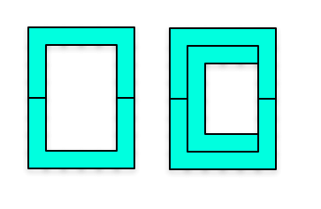      | {1,2,3,4}       |  |
|       | {1,2,3,4}       |  |
| 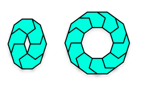      | {1,2,3,4}       |  |
|       | {1,2,3,4}       |  |
|       | {1,2,3,4}       |  |
|       | {1,2,3,4}       |  |
|       | {1,2,3,4}       |  |
| 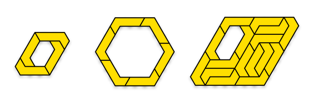      | {1,2,3,4}       |  |
|       | {1,2,3,4}       |  |
|       | {1,2,3,4}       |  |
|       | {1,2,3,4}       |  |
|       | {1,2,3,4}       |  |
| 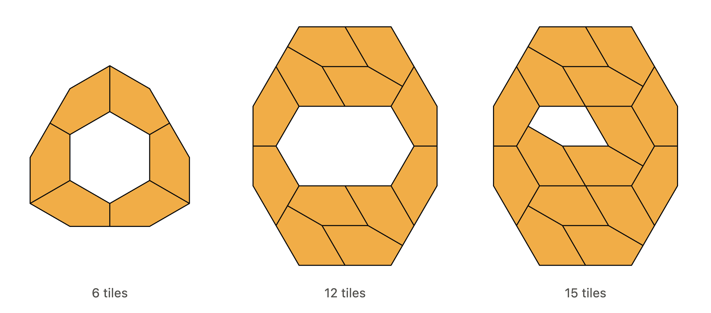      | {1,2,3,4}       |  |
|       | {1,2,3,4}       |  |
| 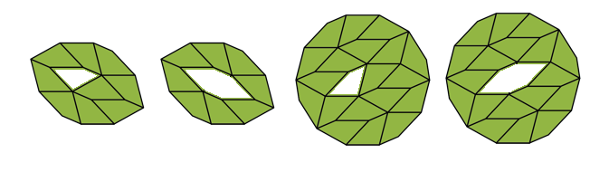      | {1,2,3,4}       |  |
| 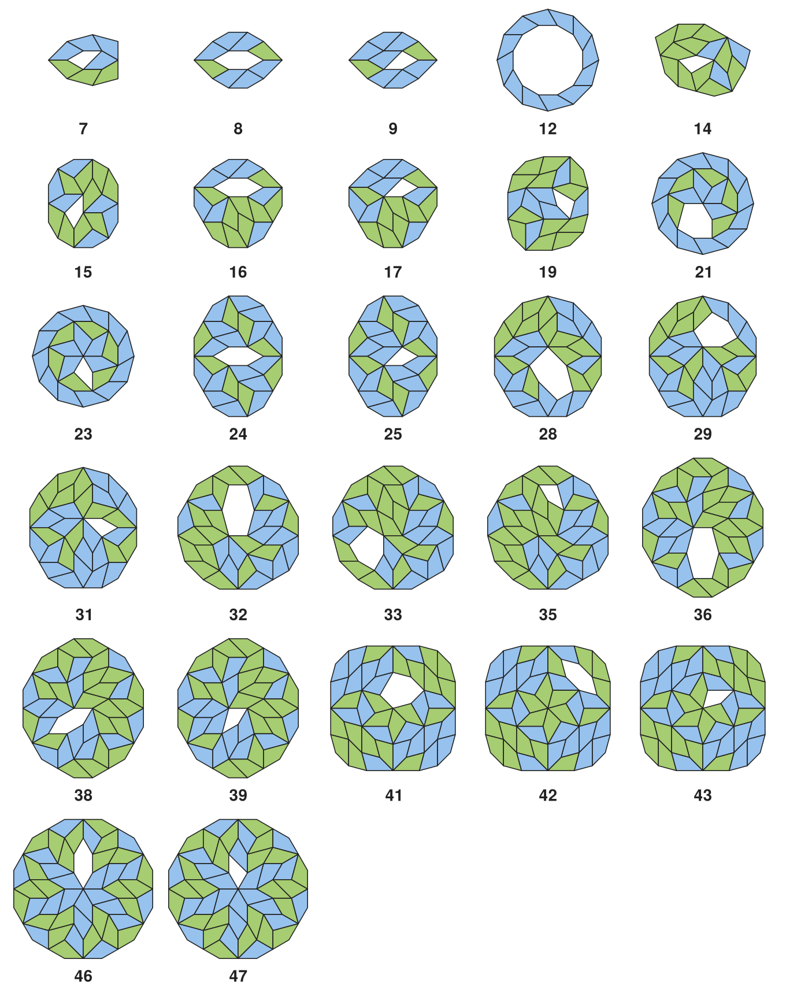      | {1,2,3,4}       |  |
| 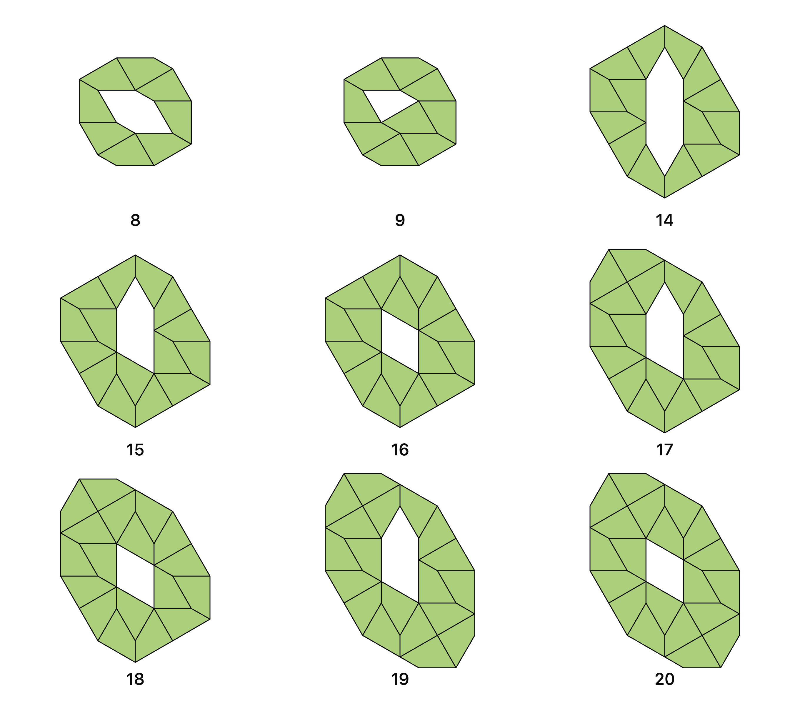      | {1,2,3,4}       |  |
| 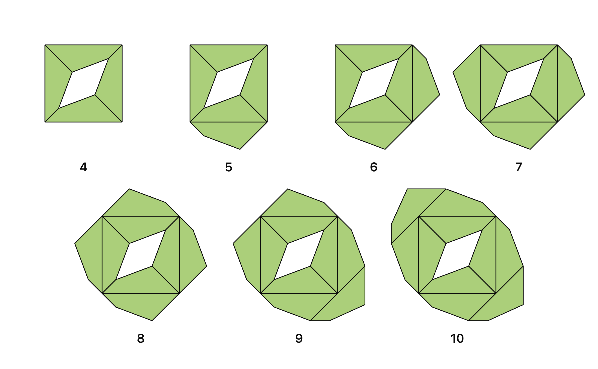      | {1,2,3,4}       |  |
|       | {1,2,3,4}       |  |
|       | {1,2,3,4}       |  |
| 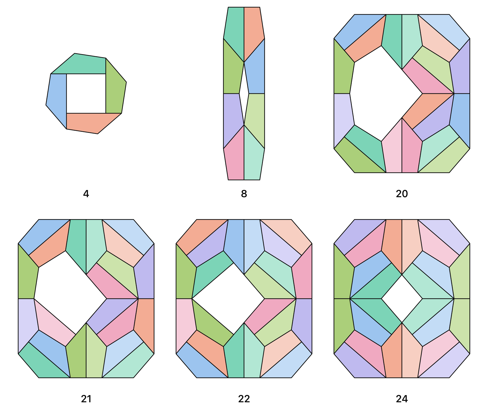      | {1,2,3,4}       |  |
| 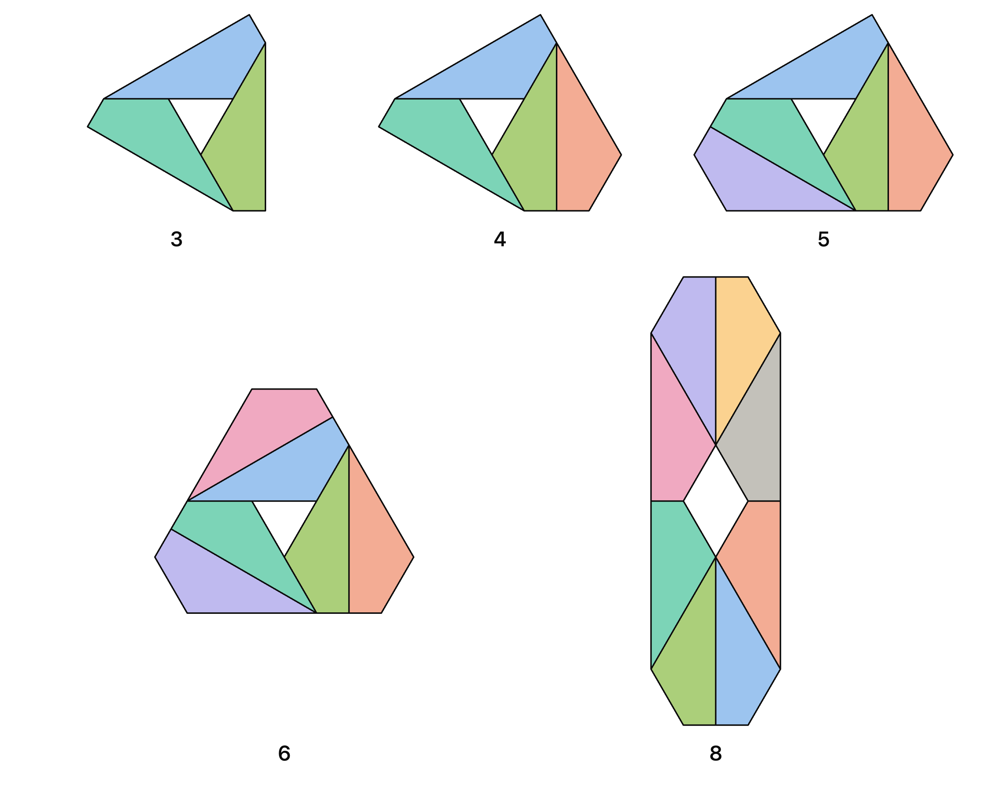      | {1,2,3,4}       |  |
|       | {1,2,3,4}       |  |
| 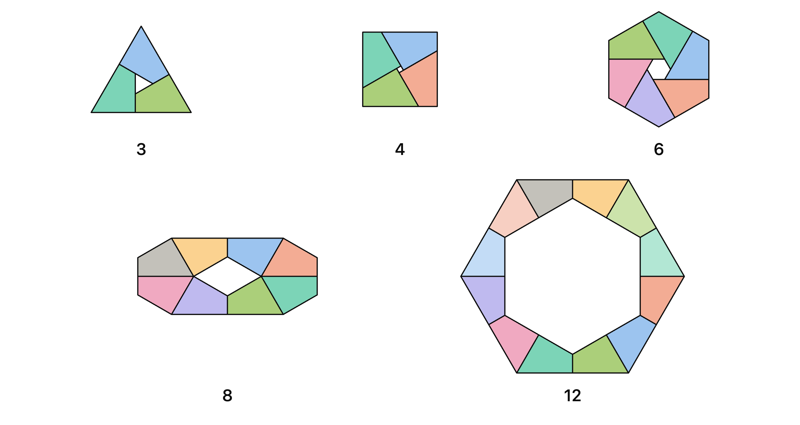      | {1,2,3,4}       |  |
| 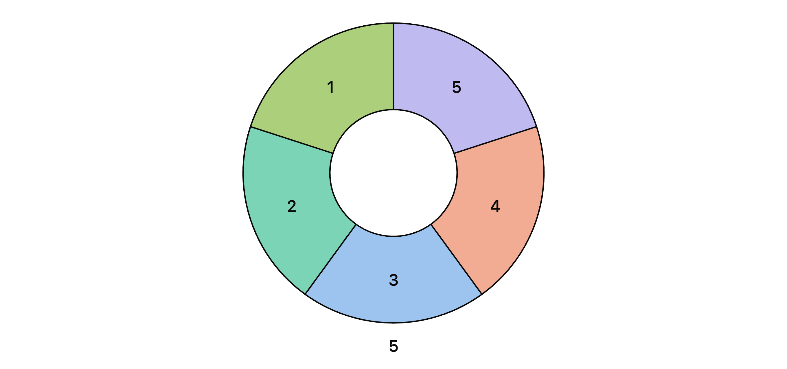      | {1,2,3,4}       |  |
